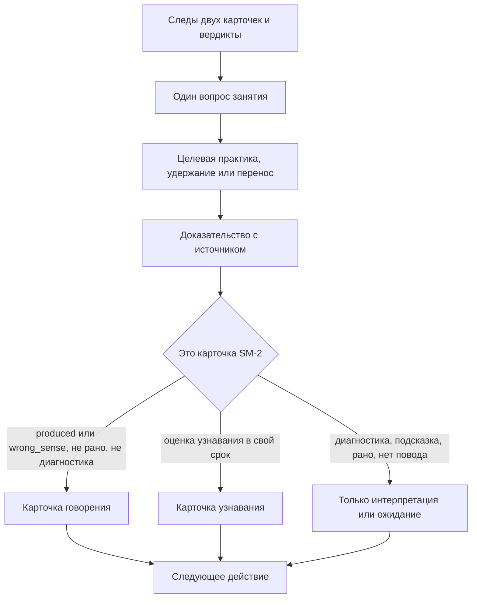
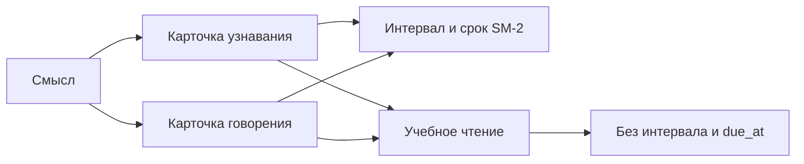
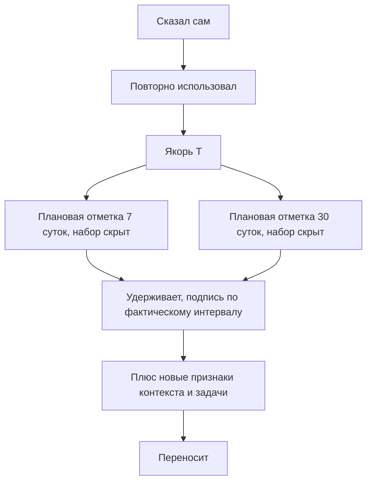
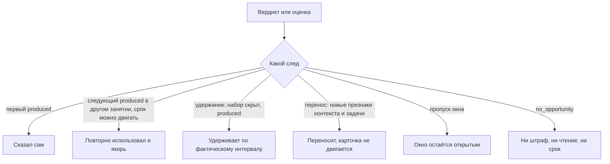
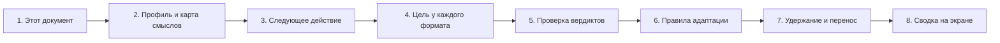

# Методика Speakeasy. Активная английская лексика

Версия 1.2. Этап 1. Дата: 2026-11-11. Основа — версия 1.1.

Это целевая методика и схема перехода. Код, база, API и интерфейс этим документом не меняются. Как программа работает сейчас, описано в [learning-process.md](../learning-process.md). Если документы расходятся, для факта «что делает код» верен `learning-process.md`, для намерения «куда идём» верен этот файл.

Первая версия учит одному маршруту смысла: знакомство, понимание, самостоятельное употребление в известном наборе, повторное использование, отложенное удержание и только затем перенос в новую коммуникативную задачу. Грамматика, выражения, аудирование и произношение здесь только обозначены как будущие навыки. Их шкалы в этом документе не строятся.

## 1. Три слоя

Каждое решение ниже относится к одному из трёх слоёв.

| Слой | Вопрос | Что с ним делать на этом этапе |
| --- | --- | --- |
| Сейчас | Что уже умеет Speakeasy | Зафиксировать и не переписывать |
| Цель | Как выглядит учебная система активной лексики | Описать правила, доказательства и следующее действие |
| Переход | Как дойти от текущего кода к цели | Разложить на шаги после этого документа и остановиться |

Слой «цель» не отменяет уже работающие правила памяти. Он читает их следы и решает, какое занятие предложить дальше.

## 2. Зачем методика

Разговор с ботом и карточки сами по себе не составляют обучение. Обучение здесь — это цепочка, в которой у каждого шага есть цель, доказательство и следствие.

Результат первой версии складывается из четырёх разных утверждений, и каждое подтверждается своим следом:

- человек понимает выбранный смысл;
- сам употребляет его, когда знает, что тренирует этот набор;
- после отдельной паузы сам употребляет его, не видя слово, перевод и список; задача при этом может оставаться знакомой;
- употребляет тот же смысл при новом контексте и новой задаче, тоже не видя слово, перевод и список.

CEFR A1–C1 задаёт язык партнёра, если пользователь его выбрал. Это ориентир речи бота, не сертификат и не ступень слова.

## 3. Принципы

1. Учитывается умение, а не число действий. Сообщения, открытия карточки и реплики бота знанием не являются.
2. Узнавание и говорение — разные умения. У каждого своя карточка и свой срок. Фраза в сцене не закрывает карточку узнавания. Оценка «знаю» не закрывает карточку говорения.
3. Слово живёт в ситуации. Единица — смысл (sense), не строка списка и не написание.
4. Самостоятельный вызов нужного смысла, когда набор заранее известен, доказывает целевое употребление. Он не доказывает перенос.
5. И удержание, и перенос требуют самостоятельного ответа при скрытом слове, переводе и списке. Перенос дополнительно требует нового контекста и новой задачи. Знакомая задача для удержания достаточна. Новые декорации или новый заголовок темы переносом не являются.
6. Повторный успех SM-2 и долгосрочное удержание — разные события. Второй успех карточки говорения может наступить уже через один день. Это «Повторно использовал». «Удерживает» ставится только отдельной проверкой. В подписи пишется фактический интервал от якоря до этой проверки, а не плановая отметка, если человек пришёл позже.
7. Занятие — коммуникативная практика с одной целью. Не экзамен на каждую реплику.
8. Следующее занятие вытекает из следов предыдущего. Правило, по которому оно выбрано, можно объяснить одной фразой.
9. Свободная практика остаётся свободной. Разговор без списка слов график карточек не двигает и перенос не подтверждает.
10. Отсутствие повода сказать слово не является ошибкой и не сдвигает срок.
11. Ранняя практика сохраняет след, но не двигает срок и не ставит якорь проверок 7 и 30 дней.
12. SM-2 остаётся единственным алгоритмом интервалов двух существующих карточек. Учебные интерпретации не получают интервала, лёгкости, числа повторов и `due_at`.
13. Партнёр говорит на том CEFR, который пользователь выбрал в сценарии, дебате или свободном чате. Подбор слова не повышает и не понижает этот уровень.
14. Китайский в эту версию методики не входит. Его код не удаляется. Когда практика китайского снова откроется, она остаётся ситуационной и без дебатов.

## 4. Что уже реализовано

Ниже только то, на что методика имеет право опираться. Это слой «сейчас».

### Две карточки и SM-2

У смысла две карточки: узнавание и говорение. Обе ведёт один и тот же SM-2. День — 24 часа, без часового пояса. Лёгкость стартует с 2.5 и не опускается ниже 1.3. Первый успех ставит интервал 1 день, второй — 6 дней, дальше интервал округляется как прежний интервал × прежняя лёгкость. Неуспех возвращает интервал к 1 дню и обнуляет серию. Формула в этом документе не пересматривается.

Из этой формулы прямо следует ограничение методики. После первого засчитанного успеха следующий плановый повтор говорения может быть уже через 24 часа. Такой повтор остаётся событием SM-2. Сам по себе он не называется удержанием.

Узнавание принимает оценку только когда срок карточки уже наступил: снова, трудно, хорошо, легко. Говорение само собирает набор: сначала слова, которые уже говорили и срок которых наступил, затем новые, не больше 5. Слова с будущим сроком в автонабор не добавляются. Ручной набор из 2–5 смыслов возвращается как есть, без добора. Раньше срока вердикт пишется, срок остаётся.

Диалог со словами начинается при 2–5 смыслах. Очередь узнавания в этот набор не подмешивается. На главной можно показать до 5 карточек узнавания, срок которых наступил. Кнопка практики всё равно собирает набор говорения.

В практике со списком человек видит, какие смыслы тренирует. Успешная речь в таком занятии — целевое самостоятельное употребление. Скрытой проверки переноса в продукте нет.

### Следы речи

В конце сцены у каждого слова набора есть вердикт. Срок карточки говорения двигают только `produced` (оценка 5) и `wrong_sense` (оценка 1), и только если слово не взято раньше срока. `produced` принимается вместе с цитатой из реплики пользователя.

`hinted`, `echoed`, `mentioned`, `unused` и `no_opportunity` срок не двигают. `no_opportunity` не штрафует. Живой прогресс по ходу реплик SM-2 не вызывает.

### Форматы, которые уже есть

Практика со словами: список, набор 2–5, сцена или дебат, привязанные к списку. Практика без слов: свободный разговор, сцена, дебат; карточки не двигаются. Уровень A1–C1, если он выбран, держит речь бота.

### Чего в текущем продукте нет

Этого методика не должна выдавать за уже сделанное.

- Профиль ученика, цели и карта знаний шире списка смыслов.
- Учебное чтение речи. Линия «Новое → Встретил → Сказал → В речи» на карточке сейчас подписана статусом узнавания. Поэтому «сказал сам» может быть в истории, а точка стоит на «Новое». Серверная функция вех смотрит на число `produced` и на узнавание вместе. Два употребления она может назвать «в речи» без другого занятия и без отложенной проверки. Целевой шкалой эта функция не является.
- Разделения «Повторно использовал», «Удерживает» и «Переносит».
- Проверок удержания, в которых скрыты слово, перевод и список.
- Проверки переноса, которая дополнительно меняет контекст и задачу.
- Занятия с разными целями. Сцена, дебат и свободный чат есть как форматы, но следующее занятие из результата не выбирается.
- Объяснения, почему предложено именно это действие.
- Пушей и писем. Срок виден внутри приложения. Методика внешние напоминания не добавляет.

## 5. Целевая система активной лексики

Цель первой версии — маршрут одного смысла и очередь таких маршрутов. Это не курс всего английского.

### Профиль

Длинной анкеты нет. Профиль собирается из того, что уже происходит.

- Выбранный CEFR там, где пользователь его задал.
- Списки и смыслы, которые человек взял в работу.
- Журнал узнавания и вердикты говорения.
- Привязанные к списку сцена и тема дебата.

Отдельный входной тест в первой версии не проводится. Диагноз — это чтение уже накопленных следов. Пока следов нет, следующее действие — знакомство со смыслами выбранного списка.

### Карта знаний

В первой версии карта — это смыслы, которые уже есть у пользователя, плюс две карточки и следы по каждому смыслу. Универсальный словарь языка, грамматика, сочетаемость и функции речи в карту не загружаются.

Рядом с карточками лежит учебное чтение. Это интерпретация доказательств. У чтения нет лёгкости, интервала, числа повторов и `due_at`. Время открытия проверки 7 или 30 дней — срок рекомендации, не срок карточки.

У смысла чтение хранит:

- ряд узнавания, как его уже считает словарь;
- интерпретацию говорения по разделу 6;
- время якоря, если «Повторно использовал» уже заработано, и состояние окон: ещё не открыто, открыто, подтверждено, не подтверждено;
- у завершённой проверки — плановую отметку, фактический интервал и число успешных повторов этого смысла между якорем и проверкой;
- описание якорной ситуации структурированными признаками контекста и коммуникативной задачи;
- допуск к переносу и результат проверки переноса, если она была;
- последнюю причину, по которой смысл попал или не попал в следующее действие.

Поля интервала, лёгкости, числа повторов и `due_at` остаются только у двух существующих карточек. Поздняя реализация может сохранить чтение в кэше. Кэш с этими полями SM-2 был бы третьей карточкой, и такая запись запрещена.

### Форматы и их цели

Форматы не заменяются. У каждого появляется одна учебная цель.

| Формат | Цель | Что видит человек | Что пишет в SM-2 |
| --- | --- | --- | --- |
| Карточка узнавания | Проверить, вспоминается ли значение | Карточку и значение после ответа | Карточку узнавания, если срок наступил |
| Знакомство в ситуации | Показать смысл в контексте | Смысл и ситуацию | Ничего |
| Сцена или дебат со списком | Целевое самостоятельное употребление | Список тренируемых смыслов | Карточку говорения по правилам вердикта |
| Сцена или дебат с подсказкой | Дать попытку до самостоятельного вызова | Список и подсказку | Ничего |
| Разбор неверного значения | Вернуть нужный смысл | Список и более прямой контекст | Карточку говорения, только если новый вердикт имеет право его двигать |
| Проверка удержания | Самостоятельный вызов после паузы | Знакомую задачу. Слово, перевод и список скрыты | Ничего |
| Проверка переноса | Тот же смысл в новой ситуации | Новые признаки контекста и задачи. Слово, перевод и список скрыты | Ничего |
| Свободный разговор, сцена или дебат без списка | Речь без цели по словам | Разговор без набора | Ничего |

Сцена и дебат не являются одним диалогом в разных оболочках. Сцена задаёт роль и обстоятельства. Дебат задаёт задачу удержать довод. Пока на экране список, оба формата остаются целевой практикой, даже если тема новая. Свободный разговор список не проверяет: случайно сказанное слово не становится ни удержанием, ни переносом.

## 6. Этапы освоения смысла

У смысла два независимых ряда карточек и отдельное учебное чтение. Чтение ничего не планирует и карточки не заменяет.

### Интерпретации — не состояния SRS

Названия «Сказал сам», «Повторно использовал», «Удерживает» и «Переносит» — подписи к доказательствам. Они отвечают на вопрос, что уже удалось показать. Они не отвечают на вопрос, когда карточка должна появиться снова.

Поэтому у интерпретации нет собственного расписания. Окно 7 или 30 дней не является `due_at`. Подтверждение окна не увеличивает интервал. Пропуск и неподтверждение не уменьшают лёгкость и не обнуляют повторы. Очередь следующего занятия может учитывать открытое окно и при этом не записывает его в карточку.

Ряд узнавания ниже — это нынешняя классификация карточки узнавания. Её слово «устойчиво» в словаре означает правило интервала карточки, а не учебное «Удерживает».

### Ряд узнавания

| Состояние карточки | След |
| --- | --- |
| Не заявлено | Оценки не было |
| Узнал с усилием | «Трудно» |
| Узнаёт | «Хорошо» или «легко» |
| Узнавание по правилу словаря | Не меньше двух успехов и интервал не меньше 6 дней, срок ещё впереди |
| Срок карточки наступил | Успех уже был, `due_at` наступил. Это повод показать карточку снова |

«Снова» не создаёт отдельной ступени речи. Карточку двигает уже существующий SM-2.

### Ряд говорения как интерпретация

| Интерпретация | Что уже доказано | Чем не является |
| --- | --- | --- |
| Не сказано | Верного самостоятельного употребления не было | — |
| Сказал сам | Один `produced`: верный смысл и цитата. Набор мог быть виден | Ни повторным использованием, ни удержанием, ни переносом |
| Повторно использовал | Более поздний `produced` в другом занятии, и этому вердикту было разрешено сдвинуть срок | Удержанием. Шаг SM-2 в один день достаточен для этой строки и недостаточен для следующей |
| Удерживает | Пройдена отдельная проверка: слово, перевод и список скрыты, задача может быть знакомой. В подписи стоит фактический интервал | Переносом и новой датой карточки |
| Переносит | Пройдена проверка удержания и дополнительно изменены структурированные признаки контекста и задачи. Слово, перевод и список скрыты | Очередным успехом SM-2 и проверкой удержания в знакомой задаче |

Попытка с опорой — режим занятия, а не интерпретация. `hinted`, `echoed` и `mentioned` оставляют чтение на «не сказано», если верного `produced` ещё не было.

Два `produced` в одном занятии остаются «Сказал сам». Второе раннее употребление, которое срок не двигает, тоже остаётся «Сказал сам» и якорь не ставит.

### Сводка для человека

Сводка показывает чтение говорения, если речь уже была. Рядом всегда виден ряд узнавания. Одна подпись не замещает другую и не выглядит как третья карточка.

| Сводка | Когда она ставится |
| --- | --- |
| Новое | Смысл не появлялся в занятии, оценки узнавания нет, `produced` нет |
| Встретил | Смысл был в занятии или показан в контексте, а `produced` ещё нет |
| Узнаёт | Есть «хорошо» или «легко», а своего `produced` нет. Это самооценка карточки узнавания, не отдельная проверка понимания. Речь карточку не обновляет |
| Сказал сам | Есть одноимённое чтение |
| Повторно использовал | Есть одноимённое чтение |
| Удерживает | Проверка удержания подтверждена. В подписи указан фактический интервал от якоря, а не плановая отметка |
| Переносит | Есть одноимённое чтение |

Если человек уже сам сказал смысл, сводка показывает речевую интерпретацию, даже когда узнавание ещё «не заявлено». Это нормально и должно быть видно.

Текущая линия на карточке так не работает: она рисует статус узнавания словами пути речи. Пока код не изменён, на экране остаётся старая линия.

### Пример короткого шага SM-2

День 0. Первый `produced`, срок карточки говорения через 1 день. Чтение: «Сказал сам». Якоря ещё нет.

День 1. Второй `produced` в новом занятии, SM-2 ставит следующий интервал 6 дней. Чтение: «Повторно использовал». Якорь T — время этого вердикта. «Удерживает» не ставится.

Плановая отметка семи суток — T+7×24 часа. Если проверка пройдена в этот момент, подпись совпадает с отметкой: «Удерживает, фактически 7 суток». Если человек приходит на 25-е сутки, то же окно закрывается с подписью «Удерживает, фактически 25 суток». Называть этот результат проверкой через 7 дней нельзя. Карточка не двигается.

Между якорем и проверкой обычные занятия и успешные повторы продолжаются. Они не переносят T и не заменяют диагностику. В записи проверки сохраняется их число: измерение относится к обычному обучению, а не к паузе без практики.

Перенос в эту цепочку не входит. Его условия заданы в разделах 7 и 12.

## 7. Критерии перехода

Переход чтения делает система по следам. Модель его не объявляет. Переход не создаёт и не сдвигает карточку.

### Вперёд

| Откуда | Куда | Какое доказательство нужно |
| --- | --- | --- |
| Новое | Встретил | Смысл показан в ситуации или входил в занятие |
| Встретил | Узнаёт | Оценка узнавания «хорошо» или «легко», своего `produced` нет |
| Новое, Встретил или Узнаёт | Сказал сам | Один `produced`: верный смысл и цитата. Видимый список допустим |
| Сказал сам | Повторно использовал | Более поздний `produced` в другом занятии, с правом сдвинуть срок |
| Повторно использовал | Удерживает | `produced` в отдельной проверке: слово, перевод и список скрыты. Знакомая задача допустима. Обычный повтор SM-2 это окно не закрывает |
| Удерживает | Переносит | Отдельная проверка, где к тем же условиям скрытия добавлены новый контекст и новая задача |

«Трудно» оставляет сводку не выше «Встретил», если своего `produced` нет.

Ранний первый `produced` даёт «Сказал сам». Часы 7 и 30 дней он не запускает.

### Целевое употребление и перенос

Целевое самостоятельное употребление происходит в практике со списком. Человек знает набор. Бот может не произносить слово первым, и всё равно занятие остаётся целевым: опора — сам факт известного списка. Такой `produced` имеет право стать «Сказал сам» или «Повторно использовал» и имеет право двигать карточку говорения по уже существующим правилам.

Перенос этим следом не ставится. Проверка удержания и проверка переноса обе требуют самостоятельного `produced`: до ответа скрыты слово, перевод и список, бот не говорит слово первым, подсказка выключена. Пока видно хотя бы одно из трёх, попытка остаётся целевой практикой и ни одну из двух проверок не закрывает.

Дальше проверки расходятся только ситуацией. Для удержания коммуникативная задача может совпадать с уже знакомой. Для переноса система дополнительно фиксирует изменение контекста и изменение задачи. Знакомая задача при скрытом слове, переводе и списке остаётся удержанием. Переносом она не становится.

### Новая коммуникативная ситуация

Ситуация собирается из трёх частей.

| Часть | Что фиксируется | Пример |
| --- | --- | --- |
| Контекст | Роли, отношения, обстоятельства и канал | Покупатель и бариста у стойки; сотрудник и руководитель перед встречей |
| Коммуникативная задача | Речевое намерение | Запросить, отказать, объяснить, убедить, согласовать, поддержать, уточнить |
| Целевое значение | Смысл, который нужно выразить | Конкретный sense, без подмены соседним |

Сравнение делает система по записанным признакам, а не по названию сценария и не по суждению модели. Модель получает уже выбранные признаки и говорит внутри них. Она не решает, новая ли ситуация.

| Признак | Где записан | Что считается изменением |
| --- | --- | --- |
| Роли участников | Контекст | Другой набор ролей |
| Отношение между ними | Контекст | Например, клиент и сотрудник вместо коллег |
| Место или канал | Контекст | Другое место или другой канал |
| Обстоятельства | Контекст | Другой повод оказаться в ситуации |
| Речевое намерение | Задача | Другой пункт закрытого списка: запросить, отказать, объяснить, убедить, согласовать, поддержать, уточнить |
| Целевое значение | Sense | Для переноса не меняется |

Перенос требует изменения хотя бы одного признака контекста и изменения речевого намерения. Совпадение или различие названия, идентификатора сценария и текста, который сочинила модель, в это сравнение не входит.

Этого недостаточно, даже если экран выглядит иначе:

- другие имена, другой интерьер, другой город при той же задаче;
- новый заголовок темы при задаче «употреби слова этого списка»;
- новая сцена, если список по-прежнему на экране;
- только новая задача при тех же ролях и обстоятельствах;
- только новый контекст при той же задаче.

Заказ напитка в другом кафе — та же задача в новых декорациях. Это не перенос. Отказ руководителю перенести встречу, тем же смыслом, без показа списка — другая задача и другой контекст. Это кандидат на перенос, если скрыты слово, перевод и список.

Якорная ситуация запоминается теми же признаками. Проверка удержания может повторить якорное намерение. Проверка переноса собирается так, чтобы хотя бы один признак контекста и намерение отличались от якоря.

### Назад

Откат чтения не стирает журнал и не является алгоритмом интервалов.

| Событие | Чтение | Карточки |
| --- | --- | --- |
| «Снова» на узнавании | Понимание по карточке больше не заявляется. Речевое чтение сохраняется | Двигается только карточка узнавания, по SM-2 |
| `wrong_sense` | Журнал уже подтверждённых результатов не чистится: остаются «Сказал сам», «Повторно использовал», «Удерживает» с фактическим интервалом и «Переносит», если они были. Текущее чтение добавляет пометку «последний след — неверный смысл». Якорь не переносится, открытые окна не закрываются | Карточка говорения двигается, только если это не диагностика и вердикт имеет на это право. Узнавание не трогается |
| Новый верный `produced` после этой ошибки | Пометка о последней ошибке снимается. Прежние подтверждения, их даты и якорь остаются | По обычному правилу вердикта, если занятие не диагностическое |
| `unused` в обычной практике | Чтение не меняется | Срок не двигается |
| `no_opportunity` | Чтение не меняется | Срок не двигается и ошибка не пишется |
| Прошло время без проверки | Чтение не опускается от тишины | Интервал сам не сжимается |

Неподтверждённый перенос не удаляет запись удержания и не пишет SM-2. Он добавляет пометку «перенос не подтверждён» и меняет следующую рекомендацию. Уже записанный перенос позднейший `wrong_sense` тоже не стирает: факт подтверждения остаётся в журнале, а текущая рекомендация учитывает ошибку.

### Якорь и два календаря

Якорь удержания — время вердикта, который впервые даёт «Повторно использовал». Это второй квалифицирующий `produced`: другое занятие, верный смысл, цитата, сроку разрешено сдвинуться. Ранняя речь якорь не ставит. Следующие обычные успехи SM-2 якорь не переносят. Первый `produced` якорь не ставит, потому что повторного использования ещё не было.

От якоря T считаются два окна удержания, в сутках по 24 часа, без календарной даты и без часового пояса:

- окно 7 дней открывается в T+7×24 часа;
- окно 30 дней открывается в T+30×24 часа.

Оба окна запускает одно и то же событие. Пропуск семидневного окна не отменяет тридцатидневное. Проверка переноса этими часами не запускается: она становится допустима после подтверждённого «Удерживает» и ждёт подходящей новой ситуации, а не наступления дня.

Карточка говорения в эти моменты живёт своим SM-2. Совпадение дня карточки и дня окна ничего не сливает: успех планового повтора остаётся «Повторно использовал» и окно не закрывает.

## 8. Доказательства реального знания

Утверждение о знании хранится вместе с источником. Без источника интерпретация не ставится.

| Претензия | Достаточное доказательство |
| --- | --- |
| Встретил | Занятие, где смысл был показан в контексте |
| Узнаёт | Запись оценки «хорошо» или «легко» |
| Узнавание по правилу словаря | Текущее правило карточки: от двух успехов и интервал от 6 дней, срок впереди |
| Сказал сам | `produced`, цитата, верный смысл, занятие и время. Видимый список допустим |
| Повторно использовал | Более поздний такой `produced` в другом занятии, с правом сдвинуть срок |
| Удерживает | `produced` с цитатой в проверке удержания после её плановой отметки: слово, перевод и список скрыты, задача может быть знакомой. Рядом записан фактический интервал и число успешных повторов после якоря |
| Переносит | Такой же самостоятельный `produced` плюс изменение хотя бы одного структурированного признака контекста и изменение речевого намерения |

Для речевого доказательства записываются: смысл, вердикт, цитата, занятие, время, двигался ли срок, была ли это диагностика, контекст, задача и был ли набор показан.

### Что доказательством не является

- Число сообщений, минут и открытий приложения.
- Слово, которое сказал бот.
- Эхо, упоминание и подсказка.
- `unused` и `no_opportunity`.
- Видимые слово, перевод или список как доказательство удержания или переноса.
- Название сценария или оценка модели «ситуация новая» как замена структурированным признакам.
- Плановая отметка 7 или 30 суток как имя проверки, которую человек прошёл в другой день.
- Смена декораций или заголовка темы при прежней задаче.
- Второй успех SM-2, в том числе через один день, как доказательство «Удерживает».
- Плановый повтор карточки, даже если он выпал на 7-й или 30-й день, как закрытие диагностического окна.
- Ранняя речь как повторное использование, как якорь и как удержание.
- Оценка «знаю» как доказательство, что человек скажет слово сам.
- `produced` как повод двигать карточку узнавания.
- Успех или пропуск любой диагностики как повод изменить интервал, срок, лёгкость или число повторов.

Сомнение решается в сторону более низкой интерпретации. Два успеха за два дня остаются «Повторно использовал».

## 9. Роль AI-преподавателя

Модель ведёт разговор. Система владеет ограничениями, карточками и переходами чтения.

### Что делает модель

- Говорит на зафиксированном CEFR и не подстраивает уровень вверх или вниз по беглости реплик.
- Создаёт ситуацию, в которой целевые смыслы уместны.
- В целевой практике не произносит слово раньше человека. Список при этом может оставаться на экране: его показывает система, и занятие от этого не становится ни удержанием, ни переносом.
- В проверке удержания и в проверке переноса не произносит целевое слово, не даёт перевод и не намекает списком. Набор на экран не выводится. Признаки задачи и контекста задаёт система. Для удержания намерение может быть знакомым. Для переноса система заранее меняет и контекст, и намерение.
- В занятии с опорой может подсказать. Подсказка остаётся подсказкой.
- Может предложить формулировку упражнения внутри уже выбранных системой смысла, цели и формата.
- Объясняет человеку причину рекомендации теми словами, которые система уже выбрала. Свою причину модель не выдумывает.
- В свободном разговоре не ведёт учёт слов и не намекает, что реплика засчитана в словарь.

### Что остаётся у системы

- Состав набора: 2–5, сначала срок говорения, потом новые, без раннего добора.
- Приём вердикта и требование цитаты для `produced`.
- Запись SM-2 и запрет записи, когда вердикт или ранняя практика не имеют права двигать срок.
- Чтение раздела 6 и переходы раздела 7.
- Выбор следующего действия по разделу 10.
- Якорь, окна 7 и 30 дней и отдельная проверка переноса.
- Запрет писать результат этих проверок в интервал, срок, лёгкость и число повторов обеих карточек.
- Сравнение структурированных признаков контекста и речевого намерения. Название сцены и оценка модели в сравнение не входят.
- Отказ считать `no_opportunity` ошибкой.

Модель не ставит «Удерживает» и «Переносит», не меняет `due_at` и не объявляет слово освоенным.

## 10. Следующее учебное действие

Рекомендация — одно действие с одной главной целью и одной фразой «почему». Свободная практика предлагается всегда и эту очередь не заменяет. Человек может отказаться от рекомендации и говорить без списка: график тогда не двигается, чтение удержания и переноса не обновляется.

Восстановление неверного значения и просроченное говорение занимают рекомендацию первыми и никому её не уступают. Остальные действия чередуются. Набор целевого говорения добирается подходящими смыслами того же списка, пока в нём не станет от 2 до 5. Ранние карточки в добор не идут. Карточки узнавания в набор говорения не идут. Диагностические проверки в этот набор не подмешиваются.

| Порядок | Условие | Действие | Фраза для человека |
| --- | --- | --- | --- |
| 1 | Последний вердикт смысла — `wrong_sense`, более позднего `produced` нет | Целевое занятие на нужный смысл, с более ясным контекстом | «В прошлый раз слово прозвучало в другом значении» |
| 2 | Есть карточки говорения, срок которых наступил | Сцена или дебат со списком | «Пора снова сказать эти слова» |
| 3 | Узнавание уже «хорошо» или «легко», своего `produced` нет | Целевое говорение этих смыслов | «Значение узнаёте, в своей речи ещё не было» |
| 4 | В выбранном списке есть новые для говорения смыслы | Знакомство и первая попытка сказать | «Эти слова ещё не звучали в вашей речи» |
| 5 | Открыто окно удержания | Отдельная проверка со скрытым словом, переводом и списком. Знакомая задача допустима. Если открыты оба окна, сначала то, чья плановая отметка раньше | «Проверяем, вспоминается ли слово без списка» |
| 6 | «Удерживает» уже есть, перенос ещё не подтверждён, и признаки новой ситуации можно собрать | Проверка переноса | «Слово скрыто. Контекст и задача другие» |
| 7 | Есть узнавание, срок которого наступил | Карточки узнавания, до 5 на главной | «Пора проверить, помните ли значение» |
| 8 | Ни одно условие выше не собрало занятие | Свободная практика | «Можно просто говорить: словарь от этого не сдвинется» |

Правила сборки:

- Пункты 1 и 2 не чередуются. Пока есть неверный смысл без более позднего верного `produced` или просроченное говорение, рекомендация берётся оттуда.
- Пункты 3 и 4 — вводная речь: слово ещё не сказано или оно новое. Вместе они занимают не больше двух рекомендаций подряд, если в это же время открыта проверка удержания, доступен перенос или есть просроченное узнавание.
- На следующей рекомендации система возвращает то из ожидающих пунктов 5, 6 и 7, которое ждёт дольше. Ожидание окна считается от его плановой отметки, ожидание узнавания — от `due_at`, ожидание переноса — от момента, когда структурированная новая ситуация стала доступна. После этого серия пунктов 3 и 4 обнуляется.
- Если пункты 5, 6 и 7 не ждут, вводная речь идёт обычным порядком таблицы.
- Смыслы пунктов 3 и 4 помогают набрать 2–5 только для целевой практики. В диагностику они не подмешиваются.
- Смыслов для целевого диалога меньше двух: такой диалог не начинается. Человеку предлагается карточка узнавания, уже открытая диагностика, свободная практика или выбор ещё одного слова. Раннее слово в пару не подставляется.
- В проверке удержания и в проверке переноса может быть от одного до пяти смыслов. Их результат в SM-2 не пишется.
- Пока идут пункты 1 или 2, диагностика и просроченное узнавание ждут. Это ожидание не провал и не успех. Новые слова в это время не рекомендуются. Ограничение в две вводные рекомендации действует, когда пункты 1 и 2 уже пусты.
- Одно и то же слово в двух списках не создаёт две учебные цели. Рекомендация смотрит на смысл. Двойной счёт в числе «Сегодня» — текущее поведение словаря, не правило этой очереди.

Рекомендация называет формат. Если к списку привязана сцена, цель «сказать» открывает её меню и сама диалог не начинает. Если привязан дебат, открывается тема. Свободный чат из этой очереди не назначается носителем слов. Проверка переноса не открывает привязанную сцену как повтор той же задачи.

## 11. Адаптация

Адаптация меняет следующее занятие. Она не переписывает SM-2, не трогает выбранный CEFR и не заводит интерпретации как карточки.

| Что произошло | Как меняется следующее занятие |
| --- | --- |
| `wrong_sense` | Следующее занятие восстанавливает верный смысл. Запись уже подтверждённого удержания или переноса остаётся, с фактическим интервалом и датой. Якорь не сдвигается |
| `unused`, повод сказать был | Те же смыслы, ситуация богаче, ещё один повод. Интервал не сбрасывается |
| `no_opportunity` | Другая ситуация, где этот смысл уместен. Ошибки нет |
| Несколько подсказок и ни одного `produced` | Занятие остаётся с опорой. Сложность задачи не растёт |
| Эхо | Слово не засчитывается. В следующем целевом занятии бот не подаёт его первым |
| Второй успех SM-2 через один или шесть дней | Чтение становится «Повторно использовал», якорь ставится один раз. Отдельная проверка удержания назначается на T+7×24 и T+30×24 |
| Подтверждено удержание | Смысл допускается к проверке переноса, когда структурированные признаки дают и новый контекст, и новую задачу |
| Успех в той же задаче при новом интерьере | Остаётся целевой практикой. Перенос не предлагается как уже пройденный |
| Человек выбрал A1–C1 | Партнёр остаётся на этом уровне во всех следующих занятиях этого режима |

Уверенность не повышает CEFR. Трудность слова и трудность языка партнёра — разные оси. Первая меняет контекст, задачу и цель занятия. Вторая меняется только когда человек сам выбирает другой уровень.

Повторяющаяся грамматическая ошибка в первой версии лексику не перестраивает. Она запоминается как будущий вход для навыка грамматики и не двигает карточку слова, пока для грамматики нет своей шкалы и своих доказательств.

## 12. Занятия и долгосрочное удержание

Занятие создаёт след. Две карточки решают, когда снова проверять узнавание или говорение по SM-2. Учебные проверки решают другие вопросы и в карточки не пишут.

### Пять разных продолжений

| Вид | Вопрос | Когда | Пишет ли SM-2 | Какое чтение может изменить |
| --- | --- | --- | --- | --- |
| Плановый повтор узнавания | Помнит ли человек значение по карточке | `due_at` карточки узнавания | Да, если срок наступил | Только ряд узнавания |
| Плановый повтор говорения | Может ли человек снова сказать смысл в известном наборе | `due_at` карточки говорения. После первого успеха это может быть уже 1 день | Да, только для `produced` и `wrong_sense`, не раньше срока | До «Повторно использовал» включительно |
| Повтор после неверного смысла | Вернётся ли нужное значение | Очередь следующего действия, выше новых слов | Только по обычному правилу вердикта, не из диагностики | Текущая пометка об ошибке. Журнал подтверждений не стирает |
| Проверка удержания | Скажет ли человек смысл сам без слова, перевода и списка. Задача может быть знакомой | Окно открывается в T+7×24 и T+30×24. Подпись результата — фактический интервал | Нет | «Удерживает» с фактическим интервалом |
| Проверка переноса | Всплывёт ли тот же смысл в новой задаче и новом контексте без набора | После подтверждённого «Удерживает», когда ситуация удовлетворяет разделу 7 | Нет | «Переносит» |

Подсказка, эхо, упоминание, пропуск и отсутствие повода интервал не назначают.

### Как занятие связано со сроком

1. Перед занятием система называет один вопрос: целевая практика, удержание, перенос или узнавание.
2. Во время занятия модель не ставит оценки в SM-2 и не объявляет интерпретацию.
3. В конце система записывает вердикт и отдельно помечает, была ли это диагностика.
4. Срок говорения меняется только у `produced` и `wrong_sense` в недиагностической практике, если она не ранняя.
5. Срок узнавания меняется только от оценки карточки в свой срок.
6. Проверка удержания и проверка переноса не меняют интервал, срок, лёгкость и число повторов.
7. Следующая рекомендация читает и чтение, и уже наступившие сроки карточек.

Плановый повтор может случиться в тот же день, что и окно удержания. Это две записи. Успех карточки не закрывает окно. Успех окна не двигает карточку.

Ранняя речь остаётся в истории. Она не создаёт якорь и не изображает новый срок, которого алгоритм не ставил.

### Проверки 7 и 30 дней

Обе проверки отвечают на один вопрос: вспомнит ли человек смысл сам. До ответа скрыты слово, перевод и список. Коммуникативная задача может оставаться знакомой, и тогда результат удержанием является, а переносом нет.

Запуск и две даты:

- событие — вердикт, впервые поставивший «Повторно использовал»;
- точка отсчёта T — время этого вердикта;
- плановая отметка — момент, когда окно становится доступно: T+7×24 часа и T+30×24 часа;
- фактический интервал — время от T до завершения проверки, в сутках по 24 часа;
- до плановой отметки окно не предлагается и провалом не считается.

В чтении и на экране пишется фактический интервал. Плановая отметка хранится рядом как служебная пометка, какое окно открылось, и не подменяет подпись. Проверка, завершённая на 25-е сутки, называется удержанием через 25 суток, даже если открылась она на отметке 7 суток.

Между T и проверкой человек продолжает обычные занятия. Успешные повторы в целевой практике двигают карточку по SM-2, не закрывают окно и не становятся сами проверкой удержания. Диагностика измеряет удержание при продолжающемся обучении. В записи проверки сохраняется число таких успешных `produced` после якоря. Ноль тоже записывается. Эти повторы не переносят T и не обнуляют измерение.

Внутри уже открытой проверки:

| Исход | Окно | Чтение | Карточки |
| --- | --- | --- | --- |
| `produced` с цитатой и верным смыслом, материалы скрыты | Это окно подтверждено | «Удерживает» с фактическим интервалом. Более ранняя открытая отметка закрывается той же записью и не получает отдельного имени «через 7 дней» | Без изменений |
| `wrong_sense` | Это окно не подтверждено | Уже записанное подтверждение с его фактическим интервалом остаётся. Текущая пометка — последняя ошибка | Без изменений от самой диагностики |
| `unused`, повод был | Это окно не подтверждено | Уже записанное подтверждение остаётся. Текущая пометка — ответ не был самостоятельным вызовом | Без изменений |
| `hinted`, `echoed`, `mentioned` | Остаётся открытым: самостоятельного ответа не было | Без повышающего изменения | Без изменений |
| `no_opportunity` | Остаётся открытым | Без изменений | Без изменений |
| Человек не открыл проверку | Остаётся открытым | Без изменений | Без изменений |

Пропуск означает, что проверку не проходили: человек отложил её, занимался другой практикой или ещё не вернулся. Пропуск не понижает чтение, не ставит «забыл» и не меняет ни одной карточки. Открытое окно продолжает ждать в очереди раздела 10, ниже ремонта значения и ниже планового повтора говорения.

Если открыты обе плановые отметки, сначала предлагается более ранняя. Один успешный ответ закрывает все уже открытые отметки одной записью. Её имя — фактический интервал, а не каждая пропущенная отметка по отдельности.

Неподтверждённая ранняя отметка не отменяет наступление следующей. Неподтверждённая поздняя не стирает уже записанный фактический интервал ранней. Новое автоматическое расписание взамен неподтверждённого окна не создаётся: иначе окно стало бы карточкой. Следующее действие может ещё раз предложить тот же вопрос как диагностику, снова без записи в SM-2. Очередь раздела 10 не даёт новым словам откладывать уже открытое окно дольше двух вводных рекомендаций.

### Проверка переноса

Она начинается после интерпретации «Удерживает». Скрытие слова, перевода и списка у неё общее с проверкой удержания. Дополнительно система заранее задаёт ситуацию, в которой хотя бы один признак контекста и речевое намерение отличаются от якоря. Плановые отметки 7 и 30 суток эту проверку не включают и модель новизну не назначает.

До ответа скрыты слово, перевод и список. На экране нет тренировочного набора. Бот не подаёт целевое слово первым.

| Исход | Чтение | Карточки |
| --- | --- | --- |
| `produced` с цитатой, условия переноса выполнены | «Переносит» | Без изменений |
| `wrong_sense` или `unused` при реальном поводе | Добавляется «перенос не подтверждён». Уже записанные удержание и перенос не удаляются. Рекомендация учитывает ошибку | Без изменений |
| Подсказка, эхо, упоминание, показанный набор или прежняя задача | Проверка не засчитана и остаётся доступной | Без изменений |
| `no_opportunity` или человек не пришёл | Проверка остаётся доступной | Без изменений |

Неподтверждённый перенос ведёт к более ясному следующему занятию. Интервал из-за него не сокращается.

Первая версия не обещает, что эти проверки измеряют «владение английским». Каждая отвечает на один вопрос по конкретным смыслам.

## 13. Как позже подключатся другие навыки

Новый навык входит в ту же рамку и не занимает карточки слова. Его состояния, если они появятся, тоже остаются интерпретацией, пока отдельное решение явно не даст им собственное расписание.

У него должны быть заранее названы:

- единица (конструкция, выражение, фрагмент на слух, звук);
- какие следы считаются доказательством;
- свои интерпретации и чем они отличаются от расписания;
- свой формат занятия;
- место в очереди следующего действия;
- пишет ли он какой-либо существующий SM-2. Для словаря ответ остаётся «нет», пока отдельное решение явно это не изменит.

| Будущий навык | Чем сможет пользоваться | Чего не делает с лексикой |
| --- | --- | --- |
| Грамматика | Повторяющиеся ошибки в уже сохранённых репликах, отдельное упражнение | Не меняет интервал смысловых карточек и не повышает «Удерживает» |
| Выражения и сочетаемость | Отдельная единица, когда она заведена | Не прячется внутрь чужого sense и не становится переносом слова |
| Аудирование | Понимание на слух как отдельное доказательство | Не засчитывается как `produced` и не закрывает перенос |
| Произношение | Оценка только там, где есть запись и заранее названный критерий | Без записи чтение слова не двигает |

Пока у навыка нет доказательств и критерия, он не появляется в очереди и не влияет на сводку слова. Расширять вердикты на грамматику, беглость и произношение можно после размеченного проверочного набора, где видны ложные зачёты и ложные отказы. Этот набор не входит в этап 1.

## 14. Переход от текущего состояния к цели

Этап 1 заканчивается этим документом и схемой. Следующие шаги описаны, чтобы их не делать все сразу. Каждый шаг сохраняет SM-2, две карточки, набор 2–5, ранний запрет сдвига, семь вердиктов и свободную практику. Ни один шаг не превращает чтение в третью карточку.

| Шаг | Что появляется | Что остаётся как сейчас |
| --- | --- | --- |
| 2. Модель ученика и карта | Чтение профиля из CEFR, списков, журнала и вердиктов. Для смысла хранятся интерпретация, якорь и состояние окон как след, без полей SM-2 | Обе карточки, их данные, формула SM-2 |
| 3. Следующее действие | Очередь раздела 10 и фраза «почему». Целевая практика, проверка удержания и проверка переноса идут разными действиями | Набор говорения не строится из очереди узнавания. На главной по-прежнему можно только показать до 5 карточек узнавания |
| 4. Цель формата | У сцены, дебата, карточки, свободного чата и двух проверок появляются цели раздела 5. Видимый список явно оставляет занятие целевой практикой | Свободный чат не пишет сроки. Новые экраны ради смены оболочек не требуются |
| 5. Доверие к оценке | Семь вердиктов сохраняются. До новых шкал собирается размеченный набор, на котором видны ложные зачёты и пропуски, включая ложный перенос из-за новой декорации | Грамматика и произношение в вердикт не добавляются |
| 6. Прозрачная адаптация | Правила раздела 11 исполняет система. Второй успех через день ставит «Повторно использовал» и якорь, а не «Удерживает» | CEFR не адаптируется моделью |
| 7. Отложенные проверки | Окна открываются в T+7×24 и T+30×24. Обе проверки скрывают слово, перевод и список. Удержание может сохранить знакомую задачу. Перенос дополнительно меняет структурированные признаки контекста и намерение. Подпись хранит фактический интервал и число промежуточных успехов | Результат не меняет интервал, срок, лёгкость и повторы. Плановый повтор SM-2 окно не закрывает |
| 8. Понятный экран | Сводка раздела 6: «Узнаёт» для самооценки карточки, удержание с фактическим интервалом, сохранённый журнал рядом с последней ошибкой, цель следующего занятия и причина | Существующая визуальная система. Линия на карточке начинает читать доказательства, а не подписывать ими статус узнавания |

Серверная функция вех на шаге 8 не используется как готовое определение «Удерживает»: она смешивает ряды и считает два употребления достаточными для «в речи». Целевые критерии — в разделах 6, 7 и 12.

Ближайший видимый разрыв уже есть в продукте: история хранит «сказал сам», а линия карточки смотрит на узнавание. Это работа шага 8, не этого документа.

Внешние напоминания, общий календарь «из любой реплики сделать следующий интервал» и слияние двух карточек в переход не входят.

## 15. Схема

### Цикл одного учебного действия

### Чтение рядом с карточками

### От повторного использования к удержанию и переносу

Второй успех SM-2 заканчивается на «Повторно использовал», даже если между попытками прошли одни сутки.

### Что делает след

### Переход по шагам

После шага 1 выполнение останавливается. Шаги 2–8 не являются заданием на код.

## 16. Граница этого этапа

Документ фиксирует методику активной лексики: этапы, переходы, доказательства, роль модели, следующее действие, адаптацию, связь занятий с удержанием и план перехода.

«Повторно использовал» — повторный целевой успех, включая короткий шаг SM-2. «Удерживает» — отдельная проверка со скрытым словом, переводом и списком; плановые отметки открывают её через 7 и 30 суток, а подпись показывает фактический интервал. «Переносит» добавляет к тому же сокрытию новый контекст и новую задачу по структурированным признакам. Подтверждённый результат остаётся в журнале и после позднейшего `wrong_sense`. Все три названия — чтение доказательств. Расписание по-прежнему только у двух карточек.

Документ не меняет SM-2, не сливает карточки, не заводит третью, не строит грамматику и не объявляет текущий экран уже соответствующим сводке. Следующий шаг начинается только отдельным решением и сразу ограничивается одним пунктом из раздела 14.
